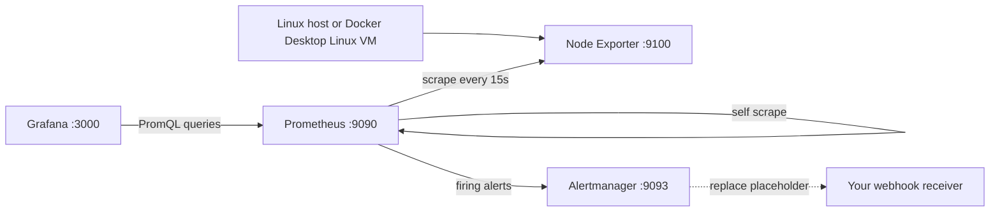

# Prometheus + Grafana Homelab Stack

A hands-on SRE monitoring portfolio lab by Matthew Coggins. This demo configures host metric collection, PromQL dashboards, alert evaluation, and incident runbooks. It is a homelab, not a production deployment, and makes no claim of use at any employer.

## Architecture



All published ports bind to 127.0.0.1. Node Exporter is reachable only inside the Compose network. Configurations are read-only bind mounts; named volumes persist Grafana state and seven days of Prometheus metrics.

## Five-minute quickstart

Prerequisites: Docker Engine on Linux or Docker Desktop with Linux containers, Docker Compose v2, and free local ports 3000, 9090 and 9093. First image downloads may take longer than five minutes.

```sh
git clone git@github.com:yellowlotuscg/prometheus-grafana-homelab-stack.git
cd prometheus-grafana-homelab-stack
docker compose config
docker compose up -d
docker compose ps
```

1. Open http://localhost:9090/targets and confirm both targets are UP.
2. Open http://localhost:3000 and log in with username `admin`, password `admin`. These are intentional demo-only credentials, not secrets. Grafana may prompt for a new password. Admin settings initialize a new volume only; they do not reset an existing user's password.
3. Open Dashboards > Homelab > Homelab Host Overview. The Prometheus datasource and dashboard are automatically provisioned, so no import is required. For a manual import exercise, use Dashboards > New > Import, upload `grafana/provisioning/dashboards/host-overview.json`, and choose a different UID/name to avoid colliding with the provisioned dashboard. The JSON references the provisioned datasource UID `prometheus`.
4. Wait for at least two scrapes for rate-based panels. Explore CPU and memory percentages, per-filesystem usage, and network receive/transmit bytes per second.
5. Trigger the safe target-down demo:

```sh
docker compose stop node-exporter
```

Watch `InstanceDown` become pending then firing at http://localhost:9090/alerts after roughly 60 to 90 seconds. After the 30-second grouping wait, inspect http://localhost:9093. Restore with:

```sh
docker compose start node-exporter
```

The alert resolves after a successful scrape and evaluation. Stopping Prometheus itself does not demonstrate self-alerting: an unavailable Prometheus cannot evaluate or send its own alerts.

## Host compatibility and security

Node Exporter is configured for a Linux host using host PID visibility and a read-only root mount. This grants substantial read access to the host, so run only on a trusted personal lab machine. On Docker Desktop, metrics describe the Linux VM, not the native macOS or Windows host. Docker Desktop filesystem mount propagation and host mounts may vary by version; inspect `docker compose logs node-exporter` if the exporter cannot start or a collector fails. Prefer native Linux for a faithful physical-host demonstration. The project has not been runtime-tested on Docker Desktop.

Do not expose this stack or its default credentials to the internet. This demo does not configure TLS, SSO, high availability, or production security controls. Image tags are pinned for repeatability, not a claim that these versions are the latest or vulnerability-free. Review advisories before using outside an isolated lab.

## Alerts and notification setup

| Alert | Condition | Hold |
| --- | --- | --- |
| InstanceDown | Any configured target has `up == 0` | 1 minute |
| HighCPU | Non-idle CPU above 85%, five-minute rate | 5 minutes |
| HighMemory | Used memory above 90%, based on MemAvailable | 5 minutes |
| DiskFilling | Writable non-pseudo filesystem below 15% available | 10 minutes |
| NodeExporterScrapeMissing | No `up` series exists for the exporter job | 2 minutes |

See [runbook.md](runbook.md) for confirmation and recovery. A stopped exporter still has `up=0`, so it triggers InstanceDown, not NodeExporterScrapeMissing. The missing-series alert catches absent target discovery/configuration; HighCPU includes I/O wait as non-idle time. DiskFilling is a free-space threshold, not a forecast.

`alertmanager/alertmanager.yml` deliberately points to an unused loopback port inside the Alertmanager container. Alerts appear in the UI, but webhook delivery fails until you replace the URL with your own reachable receiver. This demo never sends notifications to a third party by default. Do not commit real webhook tokens. Use a private local configuration for real destinations. After changing configuration, run `docker compose restart alertmanager`; for scrape/rule changes run `docker compose restart prometheus`.

## Validation

```sh
docker compose config --quiet
python3 -m venv .venv
.venv/bin/pip install PyYAML==6.0.3
.venv/bin/python scripts/validate.py
# Optional network-backed check against pinned upstream fixtures/source:
.venv/bin/python scripts/validate.py --check-upstream
# Stronger checks when Docker is running:
docker compose run --rm --no-deps --entrypoint promtool prometheus check config /etc/prometheus/prometheus.yml
docker compose run --rm --no-deps --entrypoint amtool alertmanager check-config /etc/alertmanager/alertmanager.yml
```

The Python checker validates YAML, basic alert schema, dashboard JSON, datasource references, and metric names. It is not a PromQL parser. Initial validation passed Compose configuration and Python checks, including metric verification against Node Exporter v1.9.1 upstream test output and collector source. Docker daemon was unavailable and promtool was not installed, so live scrapes, rendered panels, rule execution and notification delivery remain unverified. No live screenshot or production evidence is claimed.

## Screenshots (placeholders)

Add real captures from your own running homelab. No fabricated screenshots are included.

- [ ] Prometheus targets: both targets UP.
- [ ] Grafana overview: populated CPU, memory, disk and network panels.
- [ ] InstanceDown firing after the exporter stops.
- [ ] Alert resolved after the exporter restarts.

## Operation and cleanup

Use `docker compose logs --tail=100 prometheus grafana node-exporter alertmanager` to diagnose startup issues. `docker compose down` stops and removes containers and the network while retaining named volumes. Do not add `--volumes` unless you intentionally want to erase lab metrics and Grafana state. To upgrade, review upstream release notes, change pinned versions, validate and repeat the demo.

## License

MIT, copyright 2026 Matthew Jon Reid Coggins. See [LICENSE](LICENSE).
