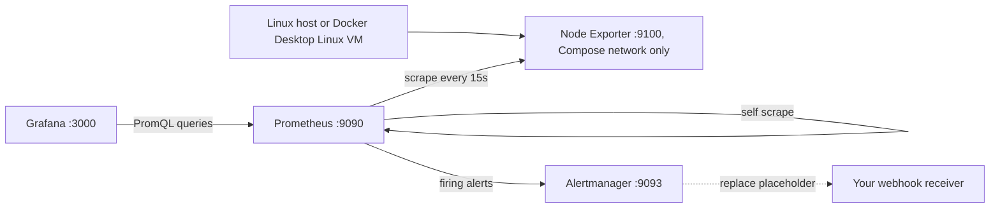

# Prometheus + Grafana Homelab Stack

A monitoring lab by Matthew Coggins. Docker Compose runs Prometheus, Grafana, Node Exporter, and Alertmanager so you can practice host metrics, a PromQL dashboard, alert rules, and a written runbook.

This is a homelab demo. It is not a production deployment, and it does not claim to be something used at any employer.

## Architecture



Published ports listen on 127.0.0.1 only. Node Exporter does not publish a host port; Prometheus scrapes `node-exporter:9100` on the Compose network. Config files are mounted read-only. Named volumes keep Grafana state, Alertmanager state, and seven days of Prometheus samples.

## Quickstart

You need Docker Engine on Linux, or Docker Desktop with Linux containers, plus Docker Compose v2. Ports 3000, 9090, and 9093 need to be free on localhost. The first image pull can take longer than the steps below.

```sh
git clone https://github.com/yellowlotuscg/prometheus-grafana-homelab-stack.git
cd prometheus-grafana-homelab-stack
docker compose config
docker compose up -d
docker compose ps
```

1. Open http://localhost:9090/targets. The `prometheus` and `node-exporter` targets should both be UP.
2. Open http://localhost:3000 and sign in as `admin` / `admin`. Those are demo credentials on purpose. Do not put this stack on the internet. Grafana may ask you to change the password. The admin user and password apply when Grafana creates a new data volume. They do not reset a password already stored in that volume.
3. Open Dashboards, then Homelab, then Homelab Host Overview. Grafana loads the Prometheus datasource and this dashboard from the files under `grafana/provisioning`, so you do not import anything for the normal path. To practice a manual import, use Dashboards > New > Import, upload `grafana/provisioning/dashboards/host-overview.json`, and choose a different UID and name so it does not collide with the provisioned dashboard. The JSON expects datasource UID `prometheus`.
4. Memory and filesystem panels can show a value after the first scrape. Scrapes run every 15 seconds. CPU and network panels use `rate(...[5m])`, so they stay empty until a second sample arrives, then settle as the five-minute window fills in.
5. Stop Node Exporter for a safe alert demo:

```sh
docker compose stop node-exporter
```

On http://localhost:9090/alerts, `InstanceDown` goes pending and then firing. From the stop, that is usually about 60 to 90 seconds: up to one scrape interval to see the target down, then the one-minute `for` hold. Prometheus sends the firing alert to Alertmanager, so http://localhost:9093 can show it at that point. The webhook is separate. Alertmanager waits `group_wait` (30 seconds) before it tries to deliver, and that attempt fails until you replace the placeholder URL below. Start the exporter again:

```sh
docker compose start node-exporter
```

The alert clears after a successful scrape and the next evaluation. Stopping Prometheus does not demonstrate self-alerting. If Prometheus is down, it cannot evaluate or send its own alerts.

## Host access and security

Node Exporter joins the host PID namespace and mounts `/` read-only (`rslave`). That is broad read access. Run it only on a machine you trust.

On Docker Desktop, the metrics come from the Linux VM, not from macOS or Windows itself. Filesystem mount propagation differs by Desktop version. If the exporter does not start, or a collector fails, read `docker compose logs node-exporter`. A host whose `/` mount is not shared will reject the `rslave` bind; `findmnt -o TARGET,PROPAGATION /` shows the propagation, and `mount --make-rshared /` is the usual fix on a lab Linux host. A native Linux host is the closer match to a physical machine. This repo has not been run on Docker Desktop.

Do not expose the stack, or the default `admin` / `admin` login, to the internet. There is no TLS, SSO, high availability, or other production control. Image tags are pinned so a clone stays repeatable. That is not a claim that those versions are current or free of vulnerabilities. Read the advisories before using the images outside an isolated lab.

## Alerts

| Alert | Condition | Hold |
| --- | --- | --- |
| InstanceDown | Any configured target has `up == 0` | 1 minute |
| HighCPU | Non-idle CPU above 85% over a five-minute rate | 5 minutes |
| HighMemory | Used memory above 90%, from MemAvailable | 5 minutes |
| DiskFilling | Writable non-pseudo filesystem below 15% free | 10 minutes |
| NodeExporterScrapeMissing | No `up` series for the exporter job | 2 minutes |

[runbook.md](runbook.md) has the checks and recovery steps. A stopped exporter still has `up=0`, so that fires InstanceDown, not NodeExporterScrapeMissing. The missing-series alert means the job or its targets disappeared. HighCPU treats I/O wait as busy, because the query only counts `mode="idle"` as idle. DiskFilling is a free-space threshold, not a forecast.

`alertmanager/alertmanager.yml` posts to `127.0.0.1:65535` inside the Alertmanager container. Nothing listens there. Alerts still show in the Alertmanager UI. Webhook delivery fails until you replace that URL with a receiver you can reach. The default config does not notify a third party. Do not commit webhook tokens. Keep a real destination in a private local file. After you change that file, run `docker compose restart alertmanager`. After scrape or rule changes, run `docker compose restart prometheus`.

## Validation

```sh
docker compose config --quiet
python3 -m venv .venv
.venv/bin/pip install PyYAML==6.0.3
.venv/bin/python scripts/validate.py
# Optional network check against the pinned Node Exporter v1.9.1 files:
.venv/bin/python scripts/validate.py --check-upstream
# Stronger checks when Docker is running:
docker compose run --rm --no-deps --entrypoint promtool prometheus check config /etc/prometheus/prometheus.yml
docker compose run --rm --no-deps --entrypoint amtool alertmanager check-config /etc/alertmanager/alertmanager.yml
```

`scripts/validate.py` checks that the YAML loads, each alert has the expected fields and a matching runbook heading, the dashboard JSON points at datasource UID `prometheus`, panel metric names match the expected set, image tags are pinned, and published ports bind to loopback. It does not parse PromQL. `--check-upstream` needs network access. It compares those metric names with the Node Exporter v1.9.1 end-to-end fixture and collector source.

GitHub Actions (`.github/workflows/validate.yml`) runs that Python checker, without `--check-upstream`, and `docker compose config --quiet` on pull requests and on pushes to `main`. You can also run the workflow by hand. CI does not start the containers, scrape a host, render Grafana, execute the alert rules, or deliver a notification.

## Screenshots

Add captures from a stack you actually started. This repo does not ship placeholder images.

- [ ] Prometheus targets: both targets UP.
- [ ] Grafana overview: CPU, memory, disk, and network panels with data.
- [ ] InstanceDown firing after Node Exporter stops.
- [ ] The same alert resolved after Node Exporter starts.

## Running and cleanup

`docker compose logs --tail=100 prometheus grafana node-exporter alertmanager` shows recent startup output. `docker compose down` removes the containers and the network and keeps the named volumes. Add `--volumes` only when you mean to delete the lab metrics, Grafana state, and Alertmanager data. To change a version, read the upstream release notes, edit the pinned tag, run the checks, and walk through the demo again.

## License

MIT. Copyright (c) 2026 Matthew Jon Reid Coggins. See [LICENSE](LICENSE).
